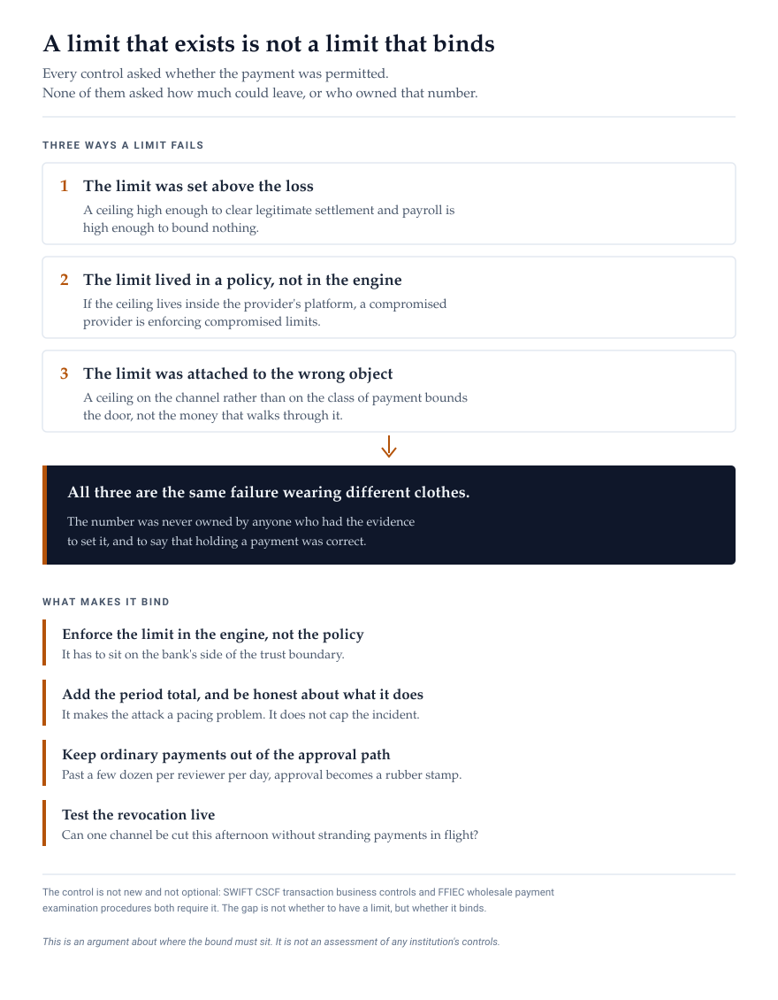

On 4 November 2026, Crédit Mutuel Arkéa confirmed that attackers had moved money out of the bank through the platform of one of its service providers. The bank has not put a figure on the loss. It said it could validate the order of magnitude of press reports putting it at roughly 118 million euros, about 133 million dollars.

They used the bank's own account to send transfers to other institutions. The provider's identity and the way its platform was compromised are both still undisclosed.

Here is the detail that matters. The bank says its monitoring detected the activity quickly. But every control that could have stopped the transfer was asking whether the instruction was authorized, and it was.

A control that tests whether a request is legitimate cannot fail a request that is legitimate.

## Every control asked the same question

Strong customer authentication verifies that a customer's payment is the customer's. Payee alerts warn a customer about a new beneficiary. Customer anomaly scoring flags a payment that does not fit a customer's history. According to the Cloud Security Alliance's analysis of the incident, protections of that kind were unlikely to have been in play, because they cover customer accounts and not transfers out of a bank's own treasury or settlement account.

The third-party program is the same story told differently. The contract, the certification, the questionnaire, the register of information the regulator requires. Every one of them describes the provider. None of them states what the connection is permitted to do.

Detection is the same story a third time. Transaction monitoring does have deterministic rules as well as statistical baselines: a new counterparty, an unusual amount, a burst of instructions. Those rules exist, and what they ask is whether this payment matches the pattern of permitted activity. That is another form of whether.

Three programs, three teams, three reasons. One question.

## The control that was missing is one the bank was already required to have

A payment limit is not a new idea and it is not optional. SWIFT's Customer Security Controls Framework includes transaction business controls as a mandatory requirement, and they exist to detect, protect and validate business transactions within the parameters of normal business. The FFIEC's examination procedures for wholesale payment systems direct examiners to confirm that release authority lists state the amount of funds each individual is authorized to release, and to assess whether there is adequate dual control over payment orders.

None of this is an assessment of what Arkéa did or did not have in place. The public record does not say, and it does not need to. The point is that the control is mandatory, so the interesting question is not whether a bank has a limit. It is why a limit that exists on paper can fail to bound anything at all.

There are only three ways that happens. The limit was set above the loss. The limit existed in a policy and was never enforced by the payment engine. Or the limit was attached to the wrong object, such as the channel rather than the class of payment.

All three are the same failure wearing different clothes. The number was never owned by anyone who had the evidence to set it.

<figure class="post-figure">
  
  <figcaption>The three ways a limit fails, the single cause they share, and what makes one bind. Every claim here is argued in the text above and below it.</figcaption>
</figure>

## Why a flat ceiling fails, and what banks already build

A single number does not work. A bank legitimately sends very large payments: interbank settlement, payroll funding, tax remittance, an acquisition. A ceiling low enough to matter is low enough to block one of those, and a ceiling high enough to clear them all is high enough to be decorative.

So banks do not use a single number. They use tiers: value bands per class of payment, with different release authorities for each. That is ordinary practice, and most institutions already have the skeleton of it in a payment authority matrix.

The work is therefore not invention. It is four specific things.

**Enforce the limit in the engine, not the policy.** If the ceiling lives inside the provider's platform, then a compromised provider is enforcing compromised limits. It has to sit on the bank's side of the trust boundary, where the bank can change it without the provider and the provider cannot change it at all.

**Add the period total, and be honest about what it does.** A per-instruction limit without a period total bounds how much one instruction may carry, not how much leaves. An attacker who learns the number sends many. The period total turns that into a pacing problem rather than a single-move problem. It does not cap the incident, because an attacker who waits for the period to reset starts again. What caps the incident is detection and revocation outrunning the period. Both are needed and neither is sufficient on its own.

**Keep ordinary payments out of the approval path.** Out-of-band confirmation only works while a reviewer can give each instruction real attention. Operational experience generally puts that ceiling at a few dozen high-value payments per reviewer per day, and past it the approval becomes a rubber stamp, which is worse than no control because it produces evidence of review. Set the threshold where the volume stays inside that envelope. And approve a new beneficiary once, at onboarding, through an allowlist with a call-back, rather than re-approving it on every payment.

**Test the revocation live.** Cutting one channel's credential takes minutes. Cutting it out of the payment engine configuration is a change-board ticket. If the second is the only available route, the first does not help. The test is whether one channel can be cut this afternoon without stranding payments already in flight.

## The number needs an owner and an argument

A limit is not a setting. It is a statement that the business is prepared to lose a stated amount through one door, and it needs what any such statement needs: a named person, evidence, a review date, and a route to change it.

The evidence is the payment profile: what this channel legitimately moves, in which value bands, to which counterparty classes, on what cadence. The owner is the person who can say, when a payment is held, that holding it was correct.

Most programs get the first two and skip the third. A limit set at go-live and never revisited becomes either loose enough to be decorative or tight enough that the business builds an exception around it, and an exception is how a control stops existing without anyone deciding that it should.

## What this does not do

It does not prevent the provider from being compromised, and nothing on the bank's side can. Everything on the bank's side determines the damage.

It does not make a legitimate request look suspicious, because the request was correct. A control that needs the attacker to do something wrong will not catch an attacker who does nothing wrong.

And it does not replace detection or the third-party program, both of which remain necessary. The limit bounds one period. Detection and revocation bound how many periods there are.

## The question to ask on Monday

Your institution is very likely required to have payment limits already, which makes the useful question sharper than whether you have them.

What is the largest single instruction your payment authority permits, who set that number, on what evidence, and when was it last reviewed.

If nobody can answer, then the limit exists on paper and the answer to how much can leave through one door is whatever fits in the window before somebody notices. Which is how a hundred million euros leaves a bank whose systems did exactly what they were designed to do.
